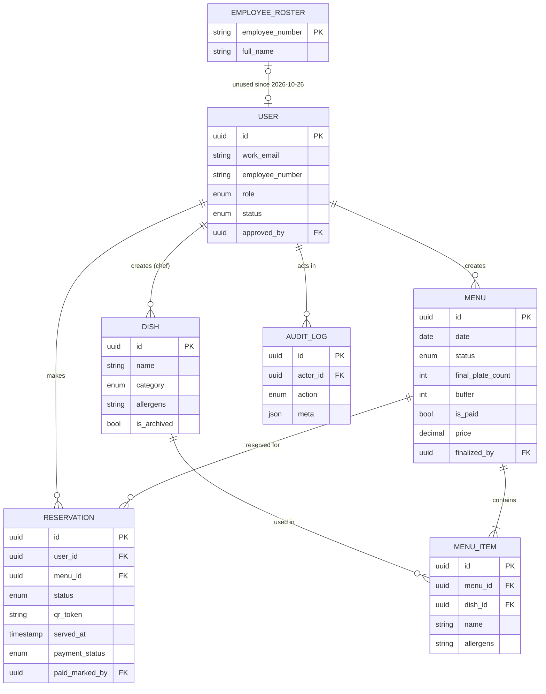
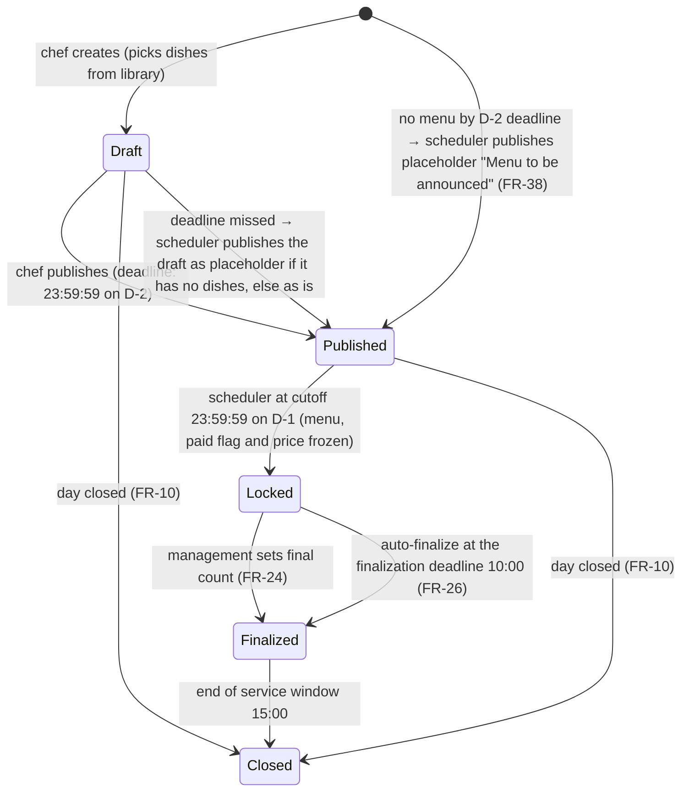
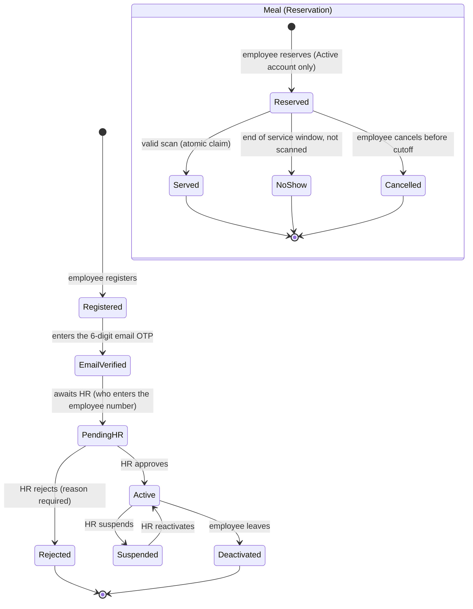
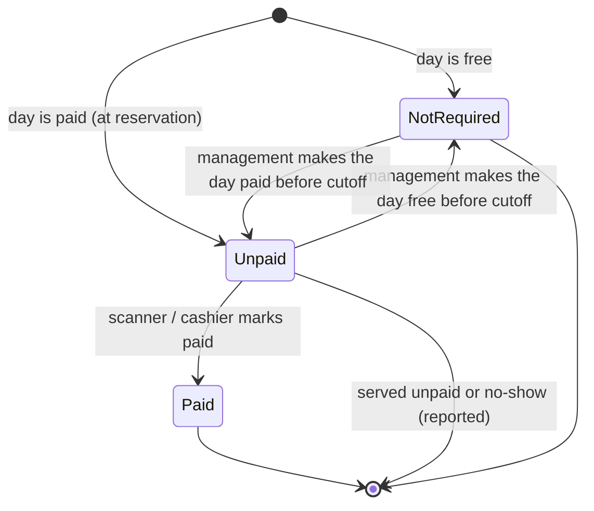

# Canteen App – Cahier des Charges & Strategy (Revised v3)

23 oct. 2026 · @ahmed · Revision 3

## Changelog v3

Decisions taken with management on 23 oct. 2026:

- **No headcount or kitchen maximum** for now. Reservations stay uncapped; an optional `kitchen_max_plates` setting exists but is empty (no ceiling on the final count).
- **Service window:** 12:00 to 15:00 by default (admin setting). Time zone Africa/Tunis.
- **Dish library:** the chef keeps a library of usual dishes and builds each day's menu from it (new **Dish** table, FR-29 to FR-31). Menus vary from day to day.
- **Payment (prepared, switched off):** meals are free today. Management can make a day paid and set its price; payment happens outside the app (cash at the counter), and the app shows and records whether each meal was paid (FR-32 to FR-36). Off by default.
- **Finalization:** management finalizes the plate count every day. Auto-finalization (FR-26) stays as the safety net.
- **One menu per day, confirmed:** every employee who reserves gets the same plate; there is never a choice between dishes.
- **Late menu publishing → placeholder menu:** if the chef has not published day D by the D-2 deadline, the system publishes a placeholder "Menu to be announced" so employees can still reserve. The chef fills in the dishes before the cutoff; employees are notified when the menu appears; management is alerted if it is still empty at the cutoff.
- **No-show policy:** reporting only during the first month, then an automatic warning email after 3 no-shows in a calendar month. No blocking in v1.
- **Walk-ins:** none in v1. A strategy for leftover plates is still open.
- **Scanning:** a dedicated phone stays in the canteen, used by the **Scanner** role. This role will later also act as **cashier** (marks meals as paid).
- **Email OTP:** email verification now uses a 6-digit one-time code instead of a link (FR-02). The OTP is used **only at registration**: no OTP at login, no OTP for password reset. New **Email OTP** table.
- **Forgotten password, two ways:** a self-service reset link by email, valid 30 minutes (FR-39), or a reset by HR/admin with a temporary password handed over in person and changed at the next login (FR-40).
- **No HR directory:** all employees register themselves. ~~HR can import a CSV of valid employee numbers to speed up approval (FR-37).~~ **[2026-10-26] Employees no longer give their employee number: HR enters it when approving the account (FR-01, FR-04). The CSV import (FR-37) and bulk approval are dropped.**
- **Hosting:** company server, already reachable from the internet (it serves the ERP desktop app and the salesmen's mobile app). The canteen app is isolated from the ERP on that server (NFR, section 5).
- **Users:** about 200 at most; performance targets sized on 200 simultaneous users at the evening cutoff.
- **Booking horizon:** no limit. Employees can reserve any day whose menu is published, however far ahead; in practice the limit is how far ahead the chef publishes.
- **Languages:** French and English at launch; Arabic later, so the interface is built right-to-left ready.
- **Data retention:** all data is kept, never deleted or anonymized (company decision).
- **Paid meals:** an unpaid meal can still be served; it stays Unpaid in the reports.
- **Arabic:** later, no date set.
- **Default buffer:** 10% of the reserved count, rounded up.
- **Technical stack:** React (web app, PWA) + Django REST Framework + Microsoft SQL Server (section 7).

## Changelog v2 (kept for history)

- Reservations are **uncapped**: no "Full" state, no first-come-first-served. FR-14 removed.
- **Menu finalization** step after the midnight cutoff: **management** (not the chef) sets the final plate count = reserved count + buffer.
- **Buffer default** lives in Settings (fixed or percentage), overridable per day by management.
- Technical hardening: idempotent reservation API, atomic QR claim, defined offline-scan sync rule, email-link expiry, injectable clock for tests, audit log extended to reservation status transitions.
- Menu lifecycle: Draft → Published → Locked (at cutoff) → Finalized → Closed.
- Chef publishing deadline (v2.1): the menu for day D must be Published before 23:59:59 on D-2.
- Database (v2.1): PostgreSQL or Microsoft SQL Server — SQL Server if the IT team wants to inspect the database with SSMS.

---

## 1. Context and objectives

The app lets verified employees reserve a canteen meal before midnight the day before, so the kitchen cooks only what will be eaten and management gets exact reserved-versus-served figures.

The working assumption is that the canteen today cannot predict how many people will eat, which causes over-production, and has no record of who actually shows up.

Objectives:

- Reduce food waste by aligning production with confirmed reservations, with a **controlled, measured buffer** decided by management.
- Allow only approved employees to use the service (HR validation of every account).
- Give the chef a fast way to publish the menu for each day, **reusing dishes from his own library**.
- Measure, per employee and per day, how many meals were reserved, finalized for production and actually collected (no-shows).
- **Be ready for paid meals:** record whether each meal was paid, without handling money in the app.
- Produce reports that HR and management can use to adjust quantities and policy.

## 2. Scope and user roles

Version 1 serves six roles and covers registration, HR approval, the dish library, daily menu, reservation, QR check-in, menu finalization, payment tracking (switched off) and reporting.

| Role | Who | Main actions |
| --- | --- | --- |
| Employee | Any staff member | Register, log in once approved, see the menu, reserve or cancel a meal, show the daily QR code |
| HR | HR team | Approve or reject new accounts, import the employee-number list, deactivate leavers, consult attendance reports |
| Chef | Head of the kitchen | Manage the dish library, publish the menu per day, see the reserved and final headcount |
| Scanner (cashier later) | Canteen staff using the dedicated canteen phone | Scan QR codes and confirm that a meal was collected; on paid days, see and mark payment status. Like every role, also reserves their own meals and gets the employee notifications (decided 2026-10-26: everyone may eat at the canteen) |
| Management | Direction / operations | Finalize the daily plate count after the cutoff, decide whether meals are paid and at what price, consult production, waste and payment reports |
| Admin | IT or app owner | Manage roles in the app's "Comptes" screen (FR-41), settings (cutoff time, service window, buffer default, payment defaults, retention), audit log |

In scope for v1:

- Account registration with HR approval and email notification.
- **Dish library** and daily menu management by the chef.
- Reservation per day with a midnight cutoff, without capacity limit.
- Post-cutoff finalization: management sets the final plate count (reserved + buffer).
- One QR code per employee per reserved day, scanned at the entrance on the dedicated canteen phone.
- **Payment tracking (feature switched off while meals are free):** paid/unpaid status per meal, marked by the scanner.
- Reports: reserved vs. finalized vs. served, no-shows, and (when enabled) paid vs. unpaid.

Out of scope for v1 (candidates for later):

- Online payment or salary deduction (payment is collected outside the app).
- Native mobile app (v1 is a responsive website, usable on a phone).
- Several canteen sites or several meal slots per day.
- A choice between several dishes per day (decided: one menu per day, same plate for everyone).
- Walk-ins and release of leftover plates.
- Meal ratings and feedback.
- Arabic interface (planned after launch).

## 3. Functional requirements

The requirements below cover the full flow from registration to reporting; M = must have for v1, S = should have, C = could have.

### 3.1 Registration and HR approval

| ID | Requirement | Priority |
| --- | --- | --- |
| FR-01 | An employee registers with first and last name, work email, department (optional) and password. **[2026-10-26] The employee does not enter an employee number; HR enters it at approval (FR-04). The form lists the password rules: at least 8 characters, not only digits, not a common password, not similar to the name or email.** | M |
| FR-02 | **[v3] The employee confirms ownership of the email with a one-time code (OTP).** Right after registration, the system emails a 6-digit code and shows a "Enter the code we sent to your email" screen. The code is valid **10 minutes** and for **one use**; after **5 wrong attempts** it is invalidated and a new code must be requested. A **"Resend code"** button is available after 60 seconds (maximum 5 codes per hour per account); requesting a new code cancels the previous one. If the employee closes the page, he can come back by logging in: an unverified account is sent to the code screen. **The OTP is used only for this registration step; logging in afterwards needs only email and password.** | M |
| **FR-39** | **Forgotten password, self-service: on "Forgot password", the employee enters his work email and receives a reset link, valid 30 minutes and usable once. The screen always answers "If this email exists, a link has been sent", so it never reveals which emails have an account. Limited to 3 requests per hour per email; a new request cancels the previous link. Setting the new password ends all the user's open sessions.** | M |
| **FR-40** | **Forgotten password, reset by HR or admin: for an employee who has no access to his email or prefers to ask, HR or admin clicks "Reset password" on the user's account. The system generates a temporary password, shown once on HR's screen to be given to the employee in person (never sent by email). At the next login the employee must choose a new password before doing anything else; the temporary password expires after 72 hours if unused. Every reset records who did it.** | M |
| FR-03 | A new account is in status Pending: login is refused with the message "Your account is waiting for HR approval". | M |
| **FR-41** | **Role assignment in the app [2026-10-25]: on the "Comptes" screen, the admin (and only the admin) changes a person's role with a dropdown (employee, HR, chef, scanner, management, admin). The admin cannot change their own role, and the last active admin cannot lose the role. Giving the admin role also opens the technical administration site (/admin); removing it closes it. Every change is recorded in the audit log (`role_change`).** | S |
| FR-04 | HR has a dashboard of pending accounts with approve and reject actions (reject requires a reason). **[2026-10-26] To approve, HR types the employee's number (matricule): required, unique across accounts. HR can correct it later on an approved account; each change is audited (`employee_number_change`). No bulk approval, since each account needs its own number.** | M |
| FR-05 | On approval the employee receives an email saying the account is now active; on rejection, an email with the reason. | M |
| FR-06 | HR can suspend, reactivate or deactivate an account (for example when someone leaves the company). | M |
| ~~FR-37~~ | ~~HR can import a CSV list of valid employee numbers (with name and department). On the pending-accounts dashboard, each registration is flagged "Matches list" or "Not on list", and matching accounts can be bulk-approved.~~ **Dropped 2026-10-26: HR enters the number at approval (FR-04). Rows already imported are kept.** | — |

### 3.2 Dish library and menu management (chef)

| ID | Requirement | Priority |
| --- | --- | --- |
| **FR-29** | **The chef manages a library of usual dishes: name, description, category (starter, main, dessert, side, drink), allergens and optional photo.** Photo rules [2026-10-25]: JPEG, PNG or WebP up to 5 MB; the server turns it upright, resizes it to 1200 px at most and saves it as JPEG. On the employees' menu cards, each day shows the photo of its main dish (or of the first dish that has one). | M |
| **FR-30** | **A dish can be edited or archived. Archived dishes disappear from the picker but stay in old menus and reports. Editing a dish never changes menus already published: each menu item keeps a copy of the dish's details at the moment it was added.** | M |
| **FR-31** | **The library offers search by name and filter by category, and shows when each dish was last served, to help the chef vary the menus.** | S |
| FR-07 | The chef creates the menu of a given day by **picking dishes from the library, or creating a new dish on the spot (which is added to the library)**. The menu for day D must be Published before 23:59:59 on D-2 (company time zone). If the chef misses this deadline, the system publishes a placeholder menu (FR-38). | M |
| **FR-38** | **Placeholder menu: at 23:59:59 on D-2, if day D has no Published menu and is not Closed, the scheduler publishes it as "Menu to be announced" (no dishes) and reservations open normally. The chef can add dishes until the cutoff on D-1; when the first dishes are saved, every employee who already reserved is notified and can still cancel until the cutoff. If the menu is still empty at the cutoff, management is alerted immediately, and the chef can still add dishes until the service window opens (exception to the cutoff lock, for placeholder menus only). Every placeholder is logged and counted in the monthly report.** | M |
| FR-08 | After the reservation cutoff, management finalizes the day: it sets the final number of plates to prepare, equal to or greater than the reserved count. The system suggests reserved count + default buffer from Settings, which management can adjust. | M |
| FR-09 | The chef can duplicate a previous menu, plan a whole week, and keep a menu in Draft until it is Published. Weekly planning is the normal way to meet the 2-day publishing deadline. | S |
| FR-10 | The chef can mark a day as closed (holiday, maintenance). | S |

### 3.3 Reservation (employee)

| ID | Requirement | Priority |
| --- | --- | --- |
| FR-11 | An employee sees the published days with their menu and reserves one plate per day. A day is reservable once its menu is Published, either by the chef or as a placeholder "Menu to be announced" (FR-38); the reservation window for day D runs from publish time until 23:59:59 on D-1. **On paid days, the price is shown before reserving.** | M |
| FR-12 | A reservation for day D is possible until 23:59:59 on day D-1; after that the button is disabled and the server rejects the request. | M |
| FR-13 | The employee can cancel a reservation until the same cutoff. | M |
| ~~FR-14~~ | Removed in v2 — there is no capacity limit; the day never shows "Full". The only limit is the cutoff time. | – |
| FR-15 | The employee gets an on-screen confirmation and a "My reservations" page (with payment status on paid days); an email confirmation is optional. | S |

### 3.4 Menu finalization (management)

| ID | Requirement | Priority |
| --- | --- | --- |
| FR-24 | After the cutoff, management sees the reserved count for day D and sets the final plate count (>= reserved count). **If `kitchen_max_plates` is set in Settings, the final count cannot exceed it; today it is empty, so there is no ceiling.** | M |
| FR-25 | The system pre-fills the proposal with reserved count + buffer default from Settings (fixed number or percentage). Management can override it per day. | M |
| FR-26 | If management has not finalized by the **finalization deadline (10:00 by default, decided 2026-10-26; never later than the service start)**, the system auto-finalizes with reserved count + default buffer, and logs the auto-finalization. | M |
| FR-27 | The final count is locked at the finalization deadline (10:00 by default); it can no longer be edited. | M |
| FR-28 | The chef receives a notification (in the app and as a phone push notification, see §8) with the final plate count once the day is finalized. | S |

### 3.5 QR code and check-in

| ID | Requirement | Priority |
| --- | --- | --- |
| FR-16 | Each confirmed reservation generates one QR code, unique to that employee and that date. | M |
| FR-17 | The QR code carries a signed random token, never personal data, and is shown in "My reservations". The employee shows it on his own phone. | M |
| FR-18 | A scanner page on the **dedicated canteen phone** (camera) validates the code: account active, correct date, reservation not cancelled, not already used. It then records the meal as Served with a timestamp. The status transition to Served is an atomic claim: one database update conditioned on status = 'Reserved'; exactly one concurrent scan can succeed. | M |
| FR-19 | An invalid, expired or already-used code shows a clear red message to the scanner. A valid code shows the employee's name and employee number for a visual check. | M |
| FR-20 | Manual fallback: the scanner can search by name or employee number and mark presence; every manual check-in is logged. | S |

### 3.6 Payment tracking (switched off while meals are free)

Payment is never handled by the app: the money is collected outside it (cash at the counter today). The app only records whether each meal was paid. The whole section is controlled by the `payment_enabled` setting, which is **off** at launch.

| ID | Requirement | Priority |
| --- | --- | --- |
| **FR-32** | **Management decides whether meals are paid: a default (free or paid, with a default price) in Settings, overridable per day. The paid flag and price of day D can be changed until the cutoff on D-1; at the cutoff they are frozen.** | S |
| **FR-33** | **Every reservation on a paid day carries a payment status: Unpaid at reservation, Paid when marked. On free days the status is Not required. If management changes a day from free to paid (or changes the price) before the cutoff, the employees who already reserved are notified and can cancel.** | S |
| **FR-34** | **On a paid day, the scan result shows a clear badge "Paid" or "To pay: X TND". The scanner (cashier) can mark the meal Paid in the same screen, in one tap, right after collecting the money. Marking Paid records who did it and when.** | S |
| **FR-35** | **An unpaid meal can still be served; it then stays Unpaid and appears in the unpaid report (decided). Marking Paid can also happen after service, for example when an employee settles later.** | S |
| **FR-36** | **Reports show, per day, per employee and per month: meals paid, meals unpaid and amounts collected, with CSV or Excel export. No-shows on paid days are reported separately (nothing was collected).** | S |

### 3.7 Reporting

| ID | Requirement | Priority |
| --- | --- | --- |
| FR-21 | The chef sees the expected headcount per day (reserved, then final after finalization) and, on the day, a live count of served meals. | M |
| FR-22 | HR sees, per employee and per period, reserved versus served meals and the no-show rate, with CSV or Excel export. | M |
| FR-23 | A management dashboard shows daily and monthly trends of reserved, finalized, served and no-shows, including the buffer actually added (final − reserved) so the effect of the buffer policy on leftovers is measurable. **When payment is enabled, it also shows paid vs. unpaid meals and amounts.** | S |

## 4. Business rules

The rules below are enforced by the server, never only by the screen, and the ones marked "To confirm" still need a decision from management.

| Rule | Detail | Status |
| --- | --- | --- |
| Account states | Registered, Email verified, Pending HR, Active, Rejected, Suspended, Deactivated. Only Active can log in and reserve. | Decided |
| Reservation cutoff | A day D can be reserved or cancelled until 23:59:59 on D-1, measured on the server clock in the company's time zone (Africa/Tunis). | Decided |
| One plate per employee per day | An employee has at most one active reservation per day. Enforced by a unique constraint on (user, date) in the database. | Decided |
| Uncapped reservations | There is no capacity limit on reservations. Any approved employee can reserve until the cutoff. | Decided (v2) |
| **Kitchen maximum** | **No maximum today. The optional `kitchen_max_plates` setting is empty; if the admin fills it later, the final plate count cannot exceed it.** | Decided (v3) |
| Booking horizon | **No limit:** an employee can reserve any day whose menu is Published, however far ahead. In practice the limit is how far ahead the chef publishes (the placeholder menu of FR-38 opens each day at the latest on D-2). An optional setting allows a limit to be added later. | Decided (v3) |
| **One menu per day** | **Each day has one menu, built by the chef from the dish library. Every employee who reserves gets the same plate; there is never a choice between dishes.** | Decided (v3) |
| Menu finalization | After the cutoff on D-1, **management** sets the final plate count for D (>= reserved count). Editable until the service window opens, then locked. If not set, auto-finalization applies (reserved + default buffer). | Decided (v3: management confirmed as owner) |
| Buffer default | **10% of the reserved count, rounded up** (e.g. 47 reserved → 5 extra → 52 plates; 0 reserved → 0 extra). Stored in Settings (fixed number or percentage) and changeable by the admin; management may override it for a given day. | Decided (v3: 10%) |
| Menu locked at cutoff | The chef can edit a menu until the cutoff; edits after reservations exist notify the employees concerned. After the cutoff the menu is locked. | Decided |
| **Menu publishing deadline** | **The menu for day D must be Published before 23:59:59 on D-2 (company time zone), proven by `Menu.published_at`. If the chef misses it, the system automatically publishes day D as a placeholder "Menu to be announced" (FR-38), so employees can reserve normally. The chef must fill in the dishes before the cutoff on D-1; employees who reserved are notified when the menu appears and can still cancel until the cutoff. If the menu is still empty at the cutoff, management is alerted and the chef may still add dishes until the service window opens. Every placeholder is logged and appears in the monthly report. (Options rejected: hard rule — day lost; management override — depends on someone reacting in time.)** | **Decided (v3)** |
| **Dish snapshot** | **A menu item copies the dish's name, description and allergens when it is added. Later edits to the dish in the library do not change existing menus.** | Decided (v3) |
| QR validity | A QR code works only on its date, only once, and only while the reservation is not cancelled and the account is Active. | Decided |
| **Service window** | **12:00 to 15:00 by default, editable by the admin. Scans are accepted only inside the window.** | Decided (v3) |
| **Service days** | **The canteen serves meals Monday to Saturday (the company works Saturdays). Sunday has no menu and no placeholder. Editable by the admin (`service_weekdays`).** | Decided (2026-10-24) |
| Offline scan sync | A scan queued offline is validated at scan time, not at sync time: the timestamp recorded is the moment of the scan. A scan made inside the service window is accepted even if synced after the window ends; a scan made outside the window is rejected. | Decided (v2) |
| No-show | A reservation not scanned by the end of the service window becomes No-show and counts in the reports. | Decided |
| **No-show consequences** | **First month after go-live: reporting only. After that: an automatic, friendly warning email after 3 no-shows in a calendar month. No blocking in v1.** | Decided (v3) |
| **Walk-ins** | **No walk-ins in v1: only employees with a reservation are served. A strategy for leftover plates (for example releasing unclaimed plates at mid-service) is not decided yet.** | Decided for v1; leftover strategy open |
| **Payment** | **Meals are free today (`payment_enabled` = off). When enabled, management sets paid/free and the price per day (default in Settings); paid flag and price are frozen at the cutoff. Money is collected outside the app; the scanner marks the meal Paid.** | Decided (v3) |
| **Serving an unpaid meal** | **Allowed: the meal is served, stays Unpaid and appears in the unpaid report until marked Paid.** | Decided (v3) |
| **Data retention** | **All data (accounts, reservations, attendance, payments, audit log) is kept indefinitely; nothing is deleted or anonymized automatically. Deactivated accounts stay in the database with their history.** | Decided (v3) |

## 5. Non-functional requirements

The app must be secure, fast at the two daily peaks (just before the cutoff and at lunch) and usable on any phone without installation. The figures are proposed targets to validate.

- **Security:** HTTPS everywhere; passwords hashed with a modern algorithm (Argon2 or bcrypt); role-based access control (employee, HR, chef, scanner, management, admin); rate limiting on login, registration and **OTP requests and attempts (60 s resend delay, 5 codes per hour, 5 attempts per code)**; OTP codes generated with a secure random generator, stored hashed, never logged in clear; an audit log of approvals, menu and dish changes, reservation status transitions (reserve, cancel, serve, no-show), **payment marking and payment settings**, manual check-ins and role changes.
- **Concurrency and idempotency:** every mutating API (reserve, cancel, finalize, scan, **mark paid**) must be idempotent or transactionally safe — a double-tap or a retried request must never create a duplicate reservation, serve a meal twice, finalize twice or mark a payment twice. The unique (user, date) constraint and the atomic claim pattern of FR-18 are the baseline.
- **Clock for tests:** all time-dependent logic (publishing deadline, cutoff, service window, no-show marking, payment freeze) must use an injectable clock.
- **QR security:** each code holds a long random token, signed by the server, bound to one reservation; it cannot be guessed, is valid on one date and is marked used at the first successful scan.
- **Privacy:** collect only name, work email, employee number, department, meal records and (when enabled) payment status; limit each role to what it needs (the chef sees counts, not individual histories; the scanner sees only the person being scanned); data is kept indefinitely (company decision), so access to individual histories is restricted by role and every export is logged; comply with Tunisian personal-data law (Loi organique n° 2004-63), including the employee's right to see his own data — a short check with HR/legal is still recommended.
- **Performance:** pages load in under 2 seconds on a mobile connection and a scan returns a result in under 1 second. Sized for **about 200 users**, all able to connect in the last minutes before the evening cutoff, and up to 200 scans over the service window. This is a light load: one server with a few CPU cores and a few GB of RAM is enough.
- **Availability:** 99% during service hours (12:00 to 15:00) and in the evening until midnight; automatic daily backups; restoration tested before go-live.
- **Network access (company server):** the app runs on the company server that is already reachable from the internet for the ERP desktop app and the salesmen's mobile app, so employees can reserve from home. **Isolation from the ERP:** the canteen app runs in its own Docker containers, with its own database (or at least its own database and login with no rights on ERP data), its own subdomain and HTTPS certificate (e.g. `cantine.company.tn`), behind the reverse proxy, so a problem in the canteen app can never reach ERP data or slow the ERP down.
- **Usability:** mobile-first responsive website; the employee flow "log in, pick a day, reserve" in 3 taps or fewer; the QR code available in one tap from the home page; the scanner screen readable at arm's length with large green / red / "to pay" results.
- **Resilience at the entrance:** if the canteen phone loses its connection, scans are queued and synced afterwards (should have) under the rule in section 4, and the manual fallback in FR-20 always works.
- **Languages:** French and English at launch; Arabic later. All texts are stored in translation files, and the layout is built **right-to-left ready** (logical CSS properties, no hard-coded left/right) so Arabic can be added without redesign.
- **Maintainability:** automated tests on the publishing deadline, cutoff, QR, finalization, payment and approval rules; environments for development, staging and production; documentation for the IT team.

## 6. Data model and schemas

Ten tables hold everything; the reservation record is the center, because it carries the QR token, the payment status and the final outcome (served or no-show). Fields from earlier versions are kept; v2 additions are marked **[v2]**, v3 additions **[v3]**.

### 6.1 Entity schemas

**User**

| Field | Type | Notes |
| --- | --- | --- |
| id | UUID / serial PK |  |
| first_name | text |  |
| last_name | text |  |
| work_email | text, unique | Used for login and verification |
| employee_number | text, NULL, unique when set | Entered by HR at approval (FR-04); NULL while the account waits. Used by scanners for the manual fallback and visual check |
| department | text |  |
| password_hash | text | Argon2 or bcrypt |
| must_change_password | boolean, default false **[v3]** | True after an HR/admin reset (FR-40); forces the change at next login |
| temp_password_expires_at | timestamp, NULL **[v3]** | 72 h after an HR/admin reset |
| role | enum: employee, HR, chef, scanner, management **[v2]**, admin |  |
| status | enum: Registered, EmailVerified, PendingHR, Active, Rejected, Suspended, Deactivated | Follows section 4 |
| email_verified_at | timestamp, NULL | NULL until the OTP of FR-02 is confirmed **[v3]** |
| preferred_language | enum: fr, en (ar later), NULL **[v3]** | Falls back to `default_language`; also the language of push notifications |
| evening_reminder | boolean, default true **[2026-10-24]** | The 20:00 "not reserved for tomorrow" notification (§8); each employee can turn it off |
| approved_by | FK → User, NULL | HR approver |
| approved_at | timestamp, NULL |  |
| rejection_reason | text, NULL | Required by FR-04 |
| created_at / updated_at | timestamp |  |

**Employee roster [v3]** — list imported by HR (FR-37). **No longer used since 2026-10-26; the table and its rows are kept.**

| Field | Type | Notes |
| --- | --- | --- |
| employee_number | text PK |  |
| full_name | text | For HR's visual check |
| department | text, NULL |  |
| imported_at | timestamp |  |
| imported_by | FK → User (HR) |  |

**Email OTP [v3]** — one-time codes for email verification at registration

| Field | Type | Notes |
| --- | --- | --- |
| id | PK |  |
| user_id | FK → User |  |
| purpose | enum: verify_email | Only purpose; kept as a field so another use could be added later without a schema change |
| code_hash | text | The 6-digit code is never stored in clear (hashed, e.g. HMAC-SHA256 with a server secret) |
| expires_at | timestamp | created_at + 10 minutes |
| attempts | integer, default 0 | Code invalidated at 5 |
| consumed_at | timestamp, NULL | Set on successful use; a consumed code can never be reused |
| invalidated_at | timestamp, NULL | Set when a new code is requested or attempts are exhausted |
| created_at | timestamp | Used for the 60 s resend delay and the 5-per-hour limit |

Constraint: at most one active code (not consumed, not invalidated, not expired) per (user_id, purpose). Validation is a single conditional update, so two simultaneous submissions cannot both succeed. Expired rows are purged daily.

**Password reset token [v3]** — self-service reset links (FR-39)

| Field | Type | Notes |
| --- | --- | --- |
| id | PK |  |
| user_id | FK → User |  |
| token_hash | text | The link carries a long random token; only its hash is stored |
| expires_at | timestamp | created_at + 30 minutes |
| used_at | timestamp, NULL | Set on use; a used link never works again |
| invalidated_at | timestamp, NULL | Set when a newer link is requested |
| created_at | timestamp | Used for the 3-per-hour limit |

**Dish [v3]** — the chef's library

| Field | Type | Notes |
| --- | --- | --- |
| id | PK |  |
| name | text | Searchable |
| description | text, NULL |  |
| category | enum: starter, main, dessert, side, drink |  |
| allergens | text / array |  |
| photo | URL / file, NULL |  |
| is_archived | boolean, default false | Archived dishes are hidden from the picker |
| last_served_on | date, derived | Shown in the picker (FR-31) |
| created_by | FK → User (chef) |  |
| created_at / updated_at | timestamp |  |

**Menu** — one menu per date

| Field | Type | Notes |
| --- | --- | --- |
| id | PK |  |
| date | date, unique | One menu per date |
| status | enum: Draft, Published, Locked, Finalized **[v2]**, Closed | Lifecycle in 6.3 |
| published_at | timestamp, NULL **[v2]** | Enforces the 2-day publishing deadline |
| is_placeholder | boolean, default false **[v3]** | True when published automatically by FR-38; stays true for reporting even after the chef adds dishes |
| menu_announced_at | timestamp, NULL **[v3]** | When the chef added the first dishes to a placeholder; triggers the notification to employees |
| capacity | integer, NULL | **UNUSED** — kept for schema compatibility; reservations ignore it |
| reserved_count | integer, derived **[v2]** | Count of active reservations; computed, or refreshed by the scheduler at cutoff |
| final_plate_count | integer, NULL **[v2]** | NULL until finalization; >= reserved_count; <= `kitchen_max_plates` when that setting is filled |
| buffer | integer, NULL **[v2]** | final_plate_count − reserved_count at finalization; frozen for reporting |
| finalized_by | FK → User, NULL **[v2]** | Management |
| finalized_at | timestamp, NULL **[v2]** |  |
| auto_finalized | boolean, default false **[v2]** | True when set by FR-26 |
| is_paid | boolean, default from Settings **[v3]** | Set by management (FR-32); frozen at cutoff |
| price | decimal(8,3), NULL **[v3]** | In TND; required when is_paid; frozen at cutoff |
| created_by | FK → User (chef) |  |
| created_at / updated_at | timestamp |  |

**Menu item** — several items per menu

| Field | Type | Notes |
| --- | --- | --- |
| id | PK |  |
| menu_id | FK → Menu |  |
| dish_id | FK → Dish **[v3]** | Source dish in the library |
| name | text | **Snapshot** copied from the dish when added **[v3]** |
| description | text | Snapshot **[v3]** |
| category | enum | Snapshot **[v3]** |
| allergens | text / array | Snapshot **[v3]** |
| photo | URL / file, NULL | Snapshot reference |
| position | integer | Display order |

**Reservation** — unique per user and date

| Field | Type | Notes |
| --- | --- | --- |
| id | PK |  |
| user_id | FK → User |  |
| menu_id / date | FK → Menu (or date) | Part of the unique rule |
| status | enum: Reserved, Cancelled, Served, No-show | Transitions in 6.4; every transition → audit log **[v2]** |
| qr_token | text, unique | Long random token, server-signed; regenerated if a reservation is re-made after cancellation |
| qr_signed_payload | text | Signed payload actually encoded in the QR |
| reserved_at | timestamp |  |
| cancelled_at | timestamp, NULL |  |
| served_at | timestamp, NULL | Set by the atomic claim in FR-18 |
| scanned_by | FK → User, NULL | Scanner who validated |
| scan_method | enum: QR, Manual **[v2]** |  |
| no_show_marked_at | timestamp, NULL **[v2]** | Set by the scheduler |
| payment_status | enum: NotRequired, Unpaid, Paid **[v3]** | NotRequired on free days |
| amount_due | decimal(8,3), NULL **[v3]** | Copied from Menu.price at cutoff |
| paid_at | timestamp, NULL **[v3]** |  |
| paid_marked_by | FK → User, NULL **[v3]** | Scanner / cashier |

Constraints: `UNIQUE (user_id, date)` for active reservations — a SQL Server filtered unique index `WHERE status <> 'Cancelled'` (declared in Django as a `UniqueConstraint` with a condition) **[v2]**. Marking Paid is a conditional update `WHERE payment_status = 'Unpaid'`, so a double tap cannot record two payments **[v3]**.

**Setting** — edited by the admin, never hard-coded

| Key | Example | Notes |
| --- | --- | --- |
| service_weekdays | **0,1,2,3,4,5** | Days the canteen serves meals, 0 = Monday … 6 = Sunday. Decided (2026-10-24): **Monday to Saturday** (the company works Saturdays) |
| cutoff_time | 23:59:59 |  |
| timezone | Africa/Tunis | Company time zone |
| service_window_start / end | **12:00 / 15:00 [v3]** | Decided default |
| finalization_deadline | **10:00** **[2026-10-26]** | Plate count locked, and auto-finalized if management did not confirm (FR-26/27); capped at the service start |
| menu_missing_reminder_time | **08:00** **[2026-10-24]** | Chef: "menus to publish" notification (§8) |
| finalization_reminder_time | **08:00** **[2026-10-24]** | Management: "confirm today's plates" notification (§8) |
| evening_reminder_time | **20:00** **[2026-10-24]** | Employees who have not reserved for tomorrow (§8) |
| booking_horizon_days | empty | Empty = no limit (decided v3); can be filled later, e.g. 14 |
| no_show_policy | **warn_after_3 [v3]** | Report only during the first month, then warning |
| no_show_grace_until | date **[v3]** | Go-live + 1 month; no warnings before this date |
| buffer_mode | **percentage** **[v2]** | Decided (v3); fixed number of plates also possible |
| buffer_value | **10** (%) **[v2]** | Decided (v3). Rounded up to a whole plate. Default used by FR-25 and FR-26 |
| kitchen_max_plates | empty **[v3]** | Optional ceiling on final_plate_count; empty = no limit |
| payment_enabled | false **[v3]** | Turns section 3.6 on |
| meal_paid_default | false **[v3]** | Default for new menus |
| meal_price_default | e.g. 2.500 **[v3]** | TND, used when a day is paid |
| currency | TND **[v3]** |  |
| default_language | fr |  |
| enabled_languages | fr, en **[v3]** | ar added later |

**Notification [2026-10-24]** — in-app notifications (§8); also the source of phone pushes

| Field | Type | Notes |
| --- | --- | --- |
| id | PK |  |
| user_id | FK → User | Recipient |
| kind | enum: accounts_pending, menu_changed, menu_announced, price_changed, day_closed, placeholder_published, placeholder_empty_at_cutoff, finalization_reminder, day_finalized, menu_missing, reservation_reminder | Text built from kind + params in the user's language |
| params | JSON | e.g. date, dishes, plate counts |
| link | text | App page opened when tapped |
| dedupe_key | text | `UNIQUE (user_id, kind, dedupe_key)`: a scheduled job that runs late or twice never notifies twice |
| created_at | timestamp |  |
| read_at | timestamp, NULL | Set when opened or "mark all as read" |
| pushed_at | timestamp, NULL | Set when the push was handled by the scheduler (sent, or no device) |

Kept indefinitely like all other data.

**Push subscription [2026-10-24]** — one per phone / browser that turned push on

| Field | Type | Notes |
| --- | --- | --- |
| id | PK |  |
| user_id | FK → User |  |
| endpoint | text, unique | Web Push address given by the browser |
| p256dh / auth | text | Browser encryption keys (not secrets of the app) |
| user_agent | text | Which phone / browser, for support |
| created_at | timestamp |  |
| revoked_at | timestamp, NULL | Turned off by the user, or refused by the push service (404/410); never deleted |

Push uses VAPID keys stored only in `.env`.

**Audit log**

| Field | Type | Notes |
| --- | --- | --- |
| id | PK |  |
| actor_id | FK → User | Who (system user for scheduled jobs) |
| action | enum: register, otp_send **[v3]**, otp_fail **[v3]**, verify_email, password_reset_request **[v3]**, password_reset **[v3]**, password_reset_by_staff **[v3]**, approve, reject, suspend, reactivate, deactivate, status_change **[2026-10-24]**, roster_import **[v3]** (no longer recorded), employee_number_change **[2026-10-26]**, dish_create **[v3]**, dish_edit **[v3]**, dish_archive **[v3]**, menu_create, menu_edit, menu_publish, placeholder_publish **[v3]**, menu_announce **[v3]**, menu_lock, finalize **[v2]**, auto_finalize **[v2]**, payment_config_change **[v3]**, reserve, cancel, serve, manual_checkin, mark_paid **[v3]**, no_show **[v2]**, no_show_warning **[v3]**, data_export **[v3]**, role_change, setting_change **[v3]** | Changes made in the Django admin are recorded too (`meta.source = django_admin`): `role_change` for role and admin rights, the matching status action (approve, suspend…) for a status change, `status_change` for any other status move. Accounts cannot be deleted from the admin. |
| target_type / target_id | text / id | What |
| old_value / new_value | text, NULL **[v2]** | For status and setting changes |
| meta | JSON (NVARCHAR(MAX) in SQL Server) | Free details (e.g., scan timestamp for offline syncs) |
| created_at | timestamp | Immutable, append-only |

### 6.2 Entity-relationship diagram

### 6.3 Menu lifecycle

### 6.4 Account and meal workflow

### 6.5 Payment status (when payment is enabled) [v3]

An account can only reserve once HR approves it; the chef builds each menu from his dish library and publishes it two days ahead; reservations stop at midnight; management finalizes the plate count; a meal counts as served only after a valid scan on the canteen phone, and a reservation not scanned by 15:00 becomes a no-show.

## 7. Technical architecture and recommended stack

A single responsive web application with one database, hosted on a company server, is enough for v1; the stack below is a default to adapt to the skills of your IT team.

| Layer | Recommendation | Why |
| --- | --- | --- |
| Front end | **React** (TypeScript, built with Vite), responsive website installable on the phone home screen as a PWA; `react-i18next` for French/English and future Arabic (RTL); a browser QR library for the scanner camera | **Decided (v3).** Works on any phone without an app store. If a native app is wanted later, React Native reuses the same API, logic and much of the know-how |
| Back end | **Django + Django REST Framework (Python)**, exposing a JSON API consumed by the React app | **Decided (v3).** Very mature and extremely well documented; built-in authentication, password hashing (Argon2), roles and permissions, time-zone handling, database migrations and a ready-made admin interface (used for Settings and support screens; roles are given in the app since 2026-10-25, FR-41); officially supported SQL Server driver from Microsoft (`mssql-django`) |
| Database | **Microsoft SQL Server** (2019 or later), its own database separate from the ERP, accessed with a dedicated login | **Decided (v3).** IT can manage and inspect it with SSMS. Filtered unique index for the one-reservation rule; JSON stored as NVARCHAR(MAX); Django connects through `mssql-django` + ODBC Driver 18. SQL Server Developer Edition is free for development; production uses the company's existing licence (or Express if the database stays under 10 GB) |
| QR code | Server-signed random token, QR image generated with a standard library | Nothing personal inside the code; scan = one API call |
| Scanner | Web page on **one dedicated canteen phone** using its camera (browser QR library), logged in with a Scanner account | No special hardware; the same screen will show payment status and the "mark paid" button |
| Email | Company SMTP server or a transactional email provider | **OTP code (email verification at registration only)**, approval, rejection, warnings. OTP emails are sent immediately (not batched) and must arrive within a few seconds; configure SPF/DKIM so they do not land in spam |
| **OTP codes [v3]** | Generated by the back end with a cryptographically secure random generator (Python `secrets` module) | 6 digits, stored hashed, valid 10 minutes, 5 attempts, one active code per user (FR-02). Used only at registration; login is email + password, with no OTP |
| Scheduled jobs | Django management commands run by a scheduler (cron in a small container, or Celery Beat if a task queue is added later) | Lock the menu at the cutoff, auto-finalize at 10:00, mark no-shows at 15:00, send reminders, daily chef reminder for days without a published menu, **publish placeholder menus at the D-2 deadline and alert management at the cutoff if a placeholder is still empty**, **monthly no-show warnings** |
| Hosting | **Company server already exposed to the internet** (it serves the ERP desktop and mobile apps). Canteen app in its own Docker containers and database, own subdomain and certificate behind the reverse proxy, no access to ERP data; daily backups stored off the server | Infrastructure already exists; employees reserve from home in the evening; ERP stays isolated |

All roles use the same application through a browser.

## 8. Notifications and email flows

Nineteen messages cover the account life cycle and the daily routine.

**Channels (decided 2026-10-24).** Messages about the **account itself** go by **email**, because the person
cannot log in yet (or has lost access). **Every other message is an in-app notification plus a phone push
notification**, never an email:

- **In-app:** a bell in the app bar with the number of unread notifications and the list of messages. Notifications
  are kept like all other data (never deleted); opening one marks it read.
- **Push:** a notification on the phone's lock screen even when the app is closed (Web Push, standard in browsers).
  Each user turns it on once per phone ("Activer les notifications"); the browser asks for permission. Push needs
  the app on HTTPS; on iPhone, the app must be added to the home screen first. If push is off or fails, the in-app
  notification is still there.

| Trigger | Recipient | Channel | Content | Priority |
| --- | --- | --- | --- | --- |
| Registration submitted | Employee | Email | **6-digit OTP code** to verify the email address (valid 10 min, resend after 60 s); the code is also in the email subject line for quick reading on a phone | M |
| **Password reset requested (FR-39)** | **Employee** | Email | **Reset link, valid 30 minutes, single use** | **M** |
| **Password changed** | **Employee** | Email | **Confirmation that the password was changed (self-service or by HR), with who to contact if it wasn't him** | **S** |
| Account approved | Employee | Email | "Your account is now active" with a login link | M |
| Account rejected | Employee | Email | Reason given by HR and who to contact | M |
| New account verified | HR | In-app + push | Accounts are waiting for approval (name and email; HR enters the employee number) | M |
| Menu changed after reservations exist | Employees who reserved | In-app + push | The change and the option to cancel before the cutoff | S |
| **Day switched to paid / price changed** | **Employees who reserved** | In-app + push | **The new price and the option to cancel before the cutoff** | S |
| **Day closed (FR-10)** | **Employees who reserved** | In-app + push | **The canteen is closed that day (reason); the reservation was cancelled** | **M** |
| Reservation confirmed | Employee | — | Not sent: the app confirms on screen and shows the QR code at once | C |
| **Evening reminder (20:00, editable)** | **Employees without a reservation for tomorrow** (only when tomorrow is open; each employee can turn it off) | In-app + push | **Tomorrow's menu and the time left before midnight** | **S** (raised 2026-10-24) |
| **Finalization reminder** | **Management** | In-app + push | **Sent at 08:00 on day D (editable): reserved count for today and a link to finalize before 10:00 (the finalization deadline)** | S |
| Day finalized | Chef | In-app + push | The final plate count (reserved + buffer) to prepare | S |
| Menu missing (2-day deadline) | Chef | In-app + push | List of the next days without a published menu, sent every morning until fixed | S |
| **Placeholder published** | **Chef (copy to management)** | In-app + push | **Day D was published as "Menu to be announced"; add the dishes before the cutoff** | **M** |
| **Menu announced** | **Employees who reserved day D** | In-app + push | **The dishes are now known; option to cancel before the cutoff** | **M** |
| **Placeholder still empty at cutoff** | **Management and chef** | In-app + push | **Day D has reservations but no dishes; the chef can still add them until the service window opens** | **M** |
| **Repeated no-shows** | **Employee** | In-app + push | **Friendly warning after 3 no-shows in a calendar month (only after the first month)** | **S** |
| **Unpaid meals (when payment is enabled)** | **Employee** | In-app + push | **Monthly reminder of unpaid meals and the amount due** | C |

## 9. Risks and open questions

The biggest risks are human rather than technical: people forgetting to reserve, shared QR codes, and a queue at the entrance.

| Risk | Impact | Mitigation |
| --- | --- | --- |
| Employees forget to reserve, so adoption stays low | Reservations do not reflect real demand | Evening reminder, booking of any published day in advance, clear communication, pilot with one department |
| A QR code is shared or screenshotted between colleagues | Inflated attendance figures | Single-use code per user and per date; the scanner screen shows the employee's name and number for a visual check |
| Queue at the entrance with **a single canteen phone** | Frustration, abandonment | Fast one-call scan, manual fallback, a second phone at peak if the pilot shows a queue |
| Weak Wi-Fi or mobile data at the canteen | Scans or QR display fail | Check coverage before go-live; queue scans offline; allow the QR to be saved for the day |
| **Canteen app shares the ERP server** | **A fault or overload in the canteen app affects the ERP, or exposes ERP data** | **Separate containers, database, login and subdomain; resource limits on the canteen containers; no database rights on ERP data** |
| **No named backup for finalization** | **Final count left to auto-finalization when management is absent** | **Auto-finalization at 10:00 (FR-26) and finalization reminder; admin can give the management role to more than one person** |
| HR approvals pile up | New employees cannot reserve for days | Daily digest, in-app + push alert to HR, a named backup approver |
| The chef does not publish the menu in time | Employees reserve without knowing the dishes | Daily reminder listing missing days, weekly planning, dish library and menu duplication; placeholder menu keeps the day reservable (FR-38); management alert if still empty at cutoff; lateness tracked monthly |
| Management forgets to finalize the day | Chef has no number to cook | Finalization reminder at 08:00, auto-finalization at 10:00 (FR-26) |
| Buffer systematically too high | Leftovers persist despite reservations | Monthly report of buffer vs. leftovers; adjust the Settings default |
| **Unpaid meals accumulate (when paid)** | **Lost revenue, disputes** | **Paid badge at scan, monthly unpaid report and reminder; unpaid meals are served but tracked until paid** |
| Staff dislike being tracked on no-shows | Resistance to the app | Explain the purpose (less waste), one month of reporting only, limit who sees individual data |

Decided on 23 oct. 2026:

- [x] Headcount and kitchen maximum → no limit for now (optional setting kept empty).
- [x] Service hours and time zone → 12:00–15:00, Africa/Tunis.
- [x] Menus → vary daily, built from the chef's dish library.
- [x] Price → free today; paid later outside the app, tracked in the app, decided by management.
- [x] Who finalizes → management.
- [x] One menu per day → same plate for everyone, no choice.
- [x] Chef misses the D-2 deadline → placeholder "Menu to be announced" (FR-38).
- [x] OTP → registration only.
- [x] Forgotten password → both: self-service reset link (FR-39) and reset by HR/admin (FR-40).
- [x] No-show policy → reporting only for one month, then warning after 3 per month.
- [x] Walk-ins → none in v1.
- [x] Scanning → employee shows his QR; a dedicated canteen phone scans (Scanner role, cashier later).
- [x] HR directory → none; self-registration, HR enters the employee number at approval (roster CSV dropped 2026-10-26).
- [x] Languages → French and English; Arabic later.
- [x] Hosting → company server, already exposed to the internet (ERP desktop and mobile apps); canteen app isolated from the ERP.
- [x] Users → about 200 maximum.
- [x] Booking horizon → no limit (any published day).
- [x] Serving an unpaid meal → allowed.
- [x] Data retention → keep everything, no deletion or anonymization.
- [x] Arabic → later, no date.
- [x] Stack → React + Django REST Framework + SQL Server.
- [x] Default buffer → 10% of reservations, rounded up.

Still to settle:

- [ ] Who backs up management for finalization when the usual person is absent?
- [ ] Leftover plates: release unclaimed plates at mid-service, or another strategy?
- [ ] Optional: short check with HR/legal that keeping all data indefinitely fits Tunisian data-protection law.

## 10. Delivery strategy and rollout

Build the smallest version that covers the full loop (register, approve, build menu from the library, reserve, finalize, scan, report), test it with one group, then open it to everyone. Payment tracking is built but stays switched off. The durations below are rough estimates to confirm with your development team.

Team and responsibilities

| Role | Who | Time needed |
| --- | --- | --- |
| Product owner | One person from HR or operations with decision power | A few hours per week |
| Developers | One full-stack developer, ideally two (front and back) | Full time during the build |
| Designer | UX/UI for the screens, the QR flow and the scanner screen | Part time in the first weeks |
| IT | Server, internet exposure, certificate, backups | Setup before development, then on call |
| Business testers | The chef, one HR officer, one manager, the canteen scanner, a few employees | Short sessions during testing and the pilot |

Rollout and change management:

- Before launch, the chef fills the dish library with his usual dishes, so the first weekly menus take minutes.
- HR imports the employee-number list so registrations can be approved quickly.
- Choose a pilot group (one department or one week of service) and tell employees why the app exists: less waste, better meals.
- Prepare a one-page guide for employees and a short training for HR, the chef, management (finalization) and the canteen scanner.
- First month: no-show reporting only; announce the warning rule before it starts.
- Keep a support channel (a mailbox or a chat) and a daily review of problems during the first two weeks.
- After the rollout, review the figures monthly with the chef, management and HR: reserved vs. finalized vs. served, buffer accuracy, no-show rate — and adjust the buffer default, booking horizon and no-show policy. Switch on payment tracking when management decides meals become paid.
